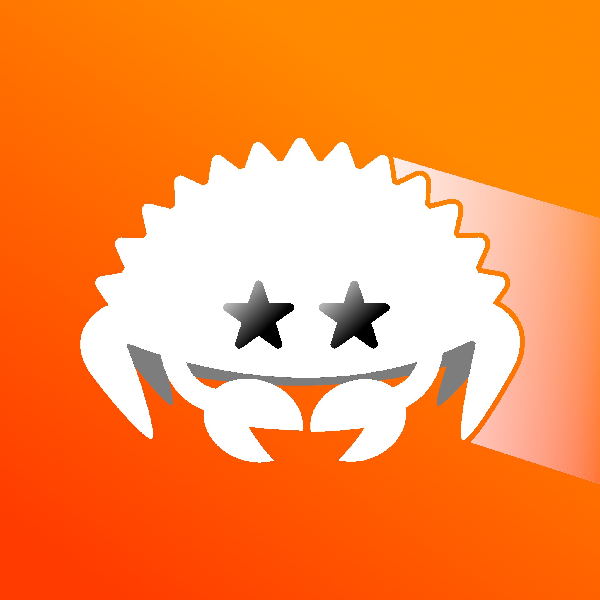

# crabrade
неофициальный нативный клиент [sharada](https://github.com/sharada-social), написанный на Rust.

 
 

 [фишки](#фишки) · [скриншоты](#скриншоты) · [установка](#установка) · [данные](#хранение-данных) · [FAQ](#faq) · [лицензия](#лицензия)

 > [!WARNING]
 > клиент находится **в активной разработке**! не готов для полноценного использования, может не покрывать все функции оригинального клиента и не успевать за обновлениями API.

> [!NOTE]
> проект **использует ИИ только для разработки UI**. функционал (API) пишется и контролируется человеком.

## что это?

crabrade (крабре́йд/крабра́да) - сторонний клиент sharada, написанный на Rust. создан с целью получить быстрый и отзывчивый ПК клиент без WebView, с расширенным функционалом, которого нет в оригинале.

- **нативный UI:** современный инструмент GPUI Kit позволяет обеспечить плавную и стабильную работу интерфейса, без использования WebView.
- **ручной бэкенд:** API клиента и хранилище сессии написаны вручную; ИИ помогает только с рзаработкой UI и оценкой остального кода.
- **расширенный функционал:** клиент предоставляет пользователю расширенные возможности, которые не предусмотрены в оригинальном клиенте.

проект не является форком официального клиента sharada.

## фишки

### как в оригинале

- вход по логину и паролю
- 2FA и первичная настройка TOTP
- кастомизация профиля
- управление аккаунтом (смена пароля, сессии, удаление)
- поиск чатов и каналов
- обмен сообщениями

### кастомные

- **история сообщений:** если пользователь удалит или изменит сообщение, клиент сохраняет оригинал
- **невидимка:** не отправлять статус "в сети" и "печатает...", не показывать статус "прочитано" у сообщений
- **несколько аккаунтов:** возможность входить сразу в несколько аккаунтов на одной установке клиента

## скриншоты

_будет заполнено после первого рабочего релиза._

## установка

_будет заполнено после первого рабочего релиза._

## хранение данных

| файл | Linux | Windows | macOS | содержит |
|---|---|---|---|---|
| `session.json` | `~/.local/share/crabrade/` | `%LOCALAPPDATA%\crabrade\` | `~/Library/Application Support/crabrade/` | токен, `device_id`, `user_id`, `username` |
| `config.json` | `~/.config/crabrade/` | `%APPDATA%\crabrade\` | `~/Library/Application Support/crabrade/` | настройки и кастомные фишки |
| `messages.db` | `~/.local/share/crabrade/` | `%LOCALAPPDATA%\crabrade\` | `~/Library/Application Support/crabrade/` | локальный архив сообщений |
| кеш | `~/.cache/crabrade/` | `%LOCALAPPDATA%\crabrade\` | `~/Library/Caches/crabrade/` | аватарки, медиа |

## faq

**это официальный клиент?** хотя разработка поддерживалась автором sharada, это сторонний клиент, использующий публичный API.

**почему GPUI?** GPUI не использует webview, даёт меньшее использование памяти, более стабильную и предсказуемую работу.

**где мой токен?** в `session.json` ([данные](#хранение-данных)). не отправляется никуда, кроме сервера.

**Будут ли звонки?** На сервере они отключены. Когда включат — можно обсудить.

**может ли прилететь бан за использование этого клиента?** API v2 официально поддерживает сторонние клиенты и crabrade честно представляется таковым. большинство кастомных фишек согласуется с владельцем. вывод делайте сами.

**какие поддерживаются OS?** поддерживаются Windows, Linux и macOS. клиент регулярно тестируется на Linux, чуть менее активно на Windows. на macOS не проверяется.

**есть телеметрия?** данные отправляются только на выбранный сервер, телеметрии и аналитики - нет.

## лицензия

код проекта распространяется по [GNU AGPL-3.0](LICENSE). это значит, что если вы используете код crabrade в своих проектах, эти проекты также должны следовать этой лицензии и быть открытыми.

лицензии на `/assets` нет, можно использовать свободно.
